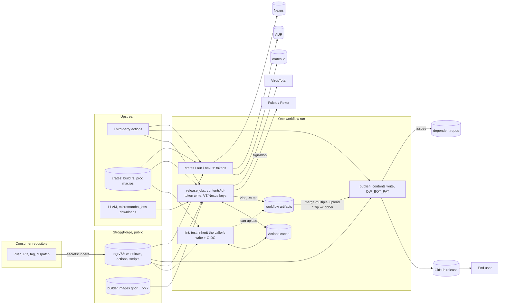
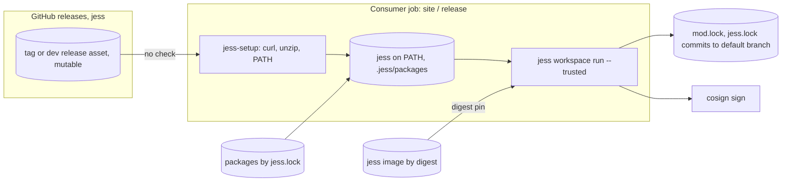
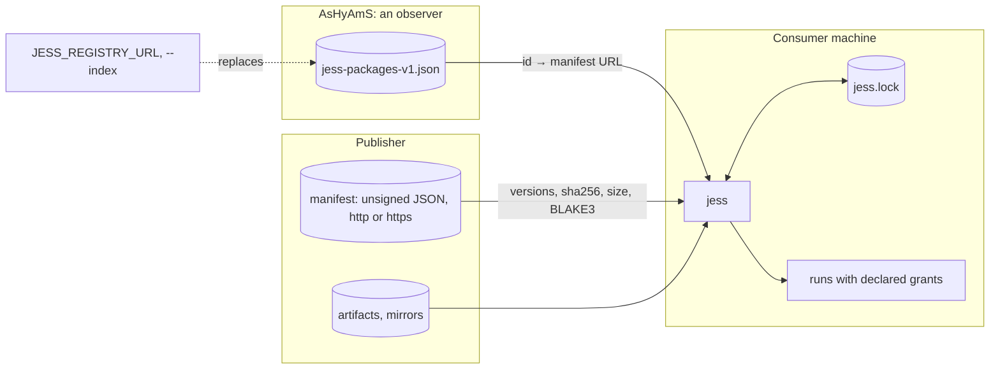
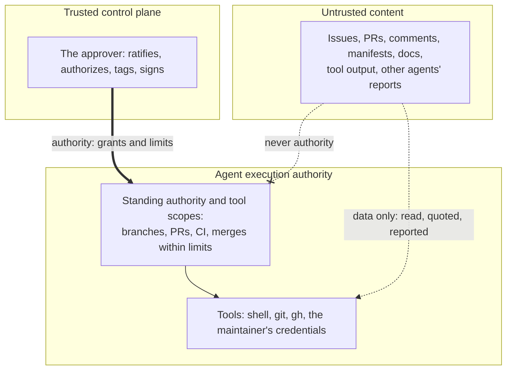
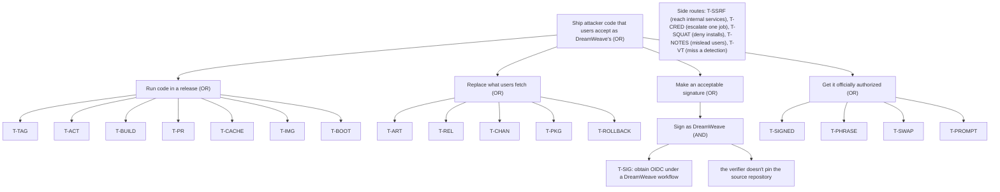

# SEC-101: the DreamWeave supply chain, source to install

Status: **proposed RFC**, second draft, for
[SEC-101](https://github.com/DreamWeave-MP/StroggForge/issues/21). It decides nothing until the sole
human approver ratifies the list under "Decisions for ratification". It authorizes no
implementation, merge, release or deployment. Each fix belongs to the issue named beside it.

**Evidence.** Read on 2026-11-12 at:

- StroggForge `6ce8bed` (`main`, which includes the tag-name fix of #70 on top of tag `v72`);
- jess `fd6c829`;
- AsHyAmS `b955dc87`;
- l3i `fe88c50`;
- repository settings through read-only `gh api`.

"Verified" means read in source or settings. "Inferred" means reasoned from documented GitHub,
Sigstore or Cargo behavior and not reproduced in a live run. The per-repository inventories, with
every citation, are in [`SEC-101-evidence.md`](SEC-101-evidence.md). The first draft was
adversarially reviewed; "Review" at the end lists what that changed.

**Recorded approver decisions.** These were made by the approver in the working session of
2026-11-12 and are recorded on #21, so they don't rest on a chat log. The standing authority was
proposed by the agent and confirmed in the approver's words: "Your standing authority
interpretation is correct. I do tags, except when I tell you to do them explicitly." It is not
inferred from permission to push branches, open PRs, or run a campaign.

- Third-party actions are pinned to full commit SHAs.
- One human approves everything in this organization: the maintainer.
- The agent's standing authority:
  - **May:** open PRs, push branches, run CI, and merge its own PRs to `main` once CI is green and
    an independent review has passed.
  - **Never:** releases, tags (unless told to), signing, secrets or permissions, production
    workflows, consumer cutover, or dependency exceptions. A merge that changes a production
    workflow is an exception the approver gives explicitly, as for #70.

  That authority interacts with several threats below. Decision 9 asks whether to narrow it.

## What is being protected

| Asset | Where it lives | Who may change it |
| --- | --- | --- |
| The reusable workflows and helpers consumers run | StroggForge `main`, tags `vN` | the maintainer |
| Consumer artifacts | GitHub releases, crates.io, AUR, Nexus Mods (zips, crates, packages, muxapps, mod archives) | each consumer's release pipeline, and the accounts behind each channel |
| jess binaries and image | jess releases (`dev`, tags), crates.io, GHCR | jess's release pipeline; officially, the human release signature (SEC-105/106) |
| Jess packages (`.jpk`, `.jsw`) and their manifests | publisher sites | each publisher |
| The package-id-to-publisher index | AsHyAmS Pages (`jess-packages-v1.json`), built from the `network-state` branch | AsHyAmS's `refresh` job, and anyone who can push AsHyAmS `main` |
| Credentials | repository and org secrets (CARGO_REGISTRY_TOKEN, AUR_SSH_PRIVATE_KEY, NEXUS_API_KEY, VT_API_KEY, DW_BOT_PAT, Discord webhooks), GITHUB_TOKEN, GitHub OIDC | GitHub, on each job's grant |
| Signing identities | Fulcio certificates for keyless cosign signatures | see "What a DreamWeave signature identifies" |
| The future official jess release key | paper, then local RAM during signing (SEC-105) | the operator, by hand |
| Build and runtime state | Actions caches, workflow artifacts, `.jess/packages`, the runner's `PATH` | any step in the jobs that touch them |

## Six things that are not the same thing

The pipelines today blur these, and most threats below exploit a blur. A seventh distinction,
between authority and instructions, gets its own section below.

| Control | What it establishes | What it does not |
| --- | --- | --- |
| **Artifact hash** (sha256, BLAKE3) | these bytes are the bytes some document named | who wrote the document; whether the bytes are safe |
| **Keyless signature** (`cosign sign-blob` with GitHub OIDC) | some job whose OIDC token carried these claims signed these bytes; the certificate names the called workflow and ref, and the source repository, ref and commit | that the job ran the intended code; that its inputs were safe; that a human wanted it released. It is not build provenance. |
| **Build provenance** (a SLSA attestation) | which source, builder and parameters produced the bytes, in a signed statement | **none exists today**; it is SEC-202's to add |
| **Malware scan** (VirusTotal) | engines didn't recognize these bytes as known malware, today | that they're benign; that they came from the source; anything about bytes not scanned |
| **GitHub approval** (PR review, environment approval) | a GitHub account clicked approve | that the account was the human and uncompromised; anything about bytes built later |
| **Human authorization** (the offline signature, SEC-105/106) | the operator, holding the paper secret, approved this exact frozen manifest | that the build was honest. Provenance shows that, and the operator reviews it before signing. |

A release is trustworthy when every control that applies holds, each checked by a party that
doesn't depend on another's word. Today:

- **A locked `jess sync`** checks hashes against a lock the consumer holds.
- **Everything else** that checks anything checks a hash against a document served from the same
  place as the bytes.
- **No consumer** verifies a signature.

### What is signed, what is scanned, and what ships

These are three different sets of files:

- **Signed:** `cosign sign-blob` signs the raw binary (`sign-release-binary.sh:12`).
- **Scanned:** VirusTotal scans the zip (`corprus-crucible/action.yml:204`).
- **Shipped:** the zip also carries the `include_files`, which no signature covers
  (`create-release-archive.sh:57,97-132`).
- **Neither signed nor scanned:** `.muxapp` packages are built later, in `publish`, from the
  repository's `mux_launch.sh` scripts (`package-muxapp.sh:33-35`).

A user who verifies the binary's signature has verified neither the archive they downloaded nor the
launch script it runs.

### What a DreamWeave signature identifies

Fulcio writes the called workflow into the certificate's identity (the SAN). For a reusable
workflow that is the callee: jess's `dev` binary is signed as
`…/StroggForge/.github/workflows/rustGlobalBuild.yml@refs/tags/v70` (evidence, "Re-checked").

StroggForge is public, so **any repository on GitHub can call `rustGlobalBuild.yml@v72` with
`id-token: write`.** Its `build.rs` or tests can then sign anything under exactly that identity
(inferred from documented Fulcio and GitHub behavior; not reproduced).

The identity alone therefore names no project. A verification identifies a DreamWeave build only
when it also pins:

- the source repository (`--certificate-github-workflow-repository`, or the Source Repository URI
  extension);
- the source ref or trigger;
- the exact identity and the issuer;
- ideally, the source commit, matched against a frozen release manifest.

`DREAMWEAVE_SIGNING_IDENTITY` (`modGlobalBuild.yml:71`), which mod archives are recorded under, has
the same gap. Decision 3 ratifies which fields every verifier pins.

## Trust boundaries

Boundaries are drawn as subgraphs; an arrow crossing one is a crossing in the tables below.

### Consumer release (StroggForge reusable workflows)



| Crossing | Authority that decides | Attacker capability that defeats it | Control today | Owner |
| --- | --- | --- | --- | --- |
| Consumer → StroggForge `@v72` | whoever can move tag `v72` | maintainer credential theft, or a token with `contents: write` on StroggForge | none: no tag ruleset, immutable releases off (ST-01, ST-02 fail) | SEC-203 |
| Job → its own scripts (`ref: v72`) | same tag | same | none | SEC-203 |
| Job → third-party actions | each action's upstream maintainer | upstream compromise or a moved tag | 2 of about 30 distinct references, about 100 uses, pinned by SHA | SEC-203; decided: SHA pins |
| Job → builder images | whoever can push `ghcr.io/…:v72` | `workflow_dispatch` of the image workflow, GHCR write | none: tags, unsigned (SR-13) | SEC-202/203 |
| Job → runtime downloads | upstream hosts, over TLS | host or CDN compromise | TLS only; `setup-llvm.sh:71` pipes `curl` into `tar` (SR-07) | SEC-201 (jess), SEC-203 |
| Job → dependency code | every crate author in the graph | a poisoned crate | `cargo audit` gates publishing only; lint and test inherit the caller's write and OIDC grants (SR-06: 21, SR-12: 14) | SEC-102 |
| Job → Actions cache | the release jobs of default-branch runs, which save the `release-target` cache (`corprus-crucible/action.yml:162-164`) | dependency code in a default-branch release build plants objects that a later tag's release job restores by key prefix (`:118-127`) and links and signs; test caches use other keys (`rust-setup/action.yml:85-93`) | none | SEC-102 |
| Job → workflow artifacts | any job in the run that can upload an artifact | a substituted or added zip or `.vt.md`; `publish` merges every `github-release-*` artifact and uploads every zip with `--clobber` (`rustGlobalBuild.yml:495-500`, `publish-github-release-artifacts.sh`) | none: no digest hand-off | SEC-102 (PR-02) |
| Job → Fulcio identity | any code in any job with `id-token: write` that runs the workflow at that ref, in any repository | any of the above, same-repo PR code, or another repository calling the public workflow | nobody verifies; the documented check pins only an org-wide pattern | SEC-202 |
| `publish` → GitHub release | the `publish` job | re-run, or `workflow_dispatch` from any branch (`rustGlobalBuild.yml:477`) | none: releases are deleted and recreated | SEC-102 |
| `publish` → dependent repositories | DW_BOT_PAT | a compromised `publish` | none | SEC-102 |
| `crates`, `aur`, `nexus` → channels | long-lived tokens and keys; the channels' own accounts | a build script during `cargo publish`'s verify build; account takeover; `aur` runs on every push to `main` (`:683`) | no environment on `crates` or `nexus` | SEC-102 |
| `docs` → GitHub Pages | `pages: write` with the `github-pages` environment | a poisoned docs build | environment branch policy only | SEC-102 |
| `notify` → Discord | the webhook URL | a leaked webhook posts as DreamWeave | none | SEC-104 (response) |
| Tag name → shell | whoever creates the tag | `$(…)` in a tag name | **fixed on `main` by #70**; consumers get it at the next StroggForge tag | done |
| End user → artifact | the user's own check | a substituted download | a bundle covering the binary only; the documented check pins an org-wide pattern (`jess site/content/docs/getting-started/install.md:35-37`) | SEC-202 |

### jess bootstrap in CI



| Crossing | Authority | Attacker capability | Control today | Owner |
| --- | --- | --- | --- | --- |
| CI → jess binary | whoever controls the release asset at that tag | asset replacement. `modGlobalBuild.yml:53` pins `v0.2.2`, but every jess release is mutable (immutable releases off), and a re-run of `publish` deletes and recreates a tagged release | none (`jess-setup/action.yml:27-32`; SR-07) | SEC-201 |
| CI → jess image | the digest in `modGlobalBuild.yml:56` | none while the digest stays | digest pin | image unsigned: SEC-202 |
| jess → workspace packages | `jess.lock` pins | first sync, or an id not yet locked | hashes from an unsigned manifest | SEC-103 |
| Check → use (`PATH`, `.jess/packages`) | the job's later steps | a step that rewrites the binary or a store entry after it was checked | none | SEC-201 |
| `--trusted` targets → the job's grants | target declarations | a malicious package | coarse capabilities, no per-package isolation (`jess src/lua/package.rs:13-16`) | SEC-103, jess |

### Package install (`jess install`, `jess workspace sync`)



| Crossing | Authority | Attacker capability | Control today | Owner |
| --- | --- | --- | --- | --- |
| jess → index | AsHyAmS Pages, built from `main` and `network-state` | AsHyAmS push or deploy compromise; a `sources.toml` PR; the environment variable | none: the index picks the publisher of an id not named with `--publisher` (`publisher.jsl:668-688`) | SEC-103, FED-101 |
| jess → manifest | whoever serves the manifest URL | publisher host compromise; MITM over `http://` | none (`publisher.jsl:155-157`) | SEC-103 |
| jess → artifact | the manifest's hashes, or the lock's on a locked sync | none, given an honest manifest or lock | size, sha256 and BLAKE3, failing closed (`publisher.jsl:562-600`, `workspace.jsl:1553-1556`) | — |
| jess → version choice | the manifest's order | a manifest listing an old vulnerable version first: the first available entry wins (`publisher.jsl:691-697`); no monotonic check | none | SEC-103 |
| jess → package-id namespace | first claimant, per the index | a claim on `org.dreamweave.*`; two claimants make jess refuse, a denial of service | none | SEC-103, FED-101 |
| jess → network | the host jess runs on | a manifest steering fetches at `127.0.0.1` or `169.254.169.254` | none: cross-origin redirects followed, no private-range filter (`http/init.jsl:55-58`) | FED-102/202, jess |
| Upgrade → user consent | prompt only when capabilities grow (`install.jsl:673-695`) | a code change under the same capabilities | none | SEC-103 |

AsHyAmS's crawler is the model for jess's own client. It:

- refuses any name that resolves to a non-public address
  (`tools/dreamweave-network/src/fetch.rs:146-170`, `src/address.rs:24,40-107`);
- connects only to the addresses it checked, with no proxy (`fetch.rs:184-186`);
- re-checks every redirect hop, at most `MAXIMUM_REDIRECTS = 5` (`policy.rs:25`);
- caps sizes and time (`policy.rs:20-54`).

Unlike jess's client, it already enforces all of these.

### Authority and instructions



Two arrows enter the agent, and they carry different things:

- **Authority** comes only from the approver. Its limits are recorded (above, and decision 9), and
  the agent's credentials should enforce them (PR-08).
- **Content** is data. The agent reads it, may quote it, and reports any instruction it finds to the
  approver. Content never adds to the agent's authority, whoever appears to have written it: an
  issue, a manifest, a review, or another agent's report.

**Today, the separation rests on the agent's conduct.** The agent's credentials are the
maintainer's, so the tools can do more than the policy allows. That gap is T-PROMPT's, and
DOC-101, DOC-103 and STE-102 build on this boundary.

## Adversaries

| ID | Adversary | Starting capability |
| --- | --- | --- |
| A1 | Outside attacker | opens PRs and issues; publishes crates and packages; serves HTTP; calls public reusable workflows from its own repositories |
| A2 | Compromised upstream | controls a third-party action, a crate, a base image or a tool download host. Its code can ship with honest provenance. |
| A3 | Compromised publisher | controls one publisher's site or manifest |
| A4 | Compromised maintainer credential | a GitHub session, PAT or SSH key of the maintainer, or DW_BOT_PAT's account |
| A5 | Compromised CI job | code in one job, with that job's token, secrets, OIDC, cache and artifact access |
| A6 | Malicious-but-authorized releaser | runs the real release and signs; ships bad code with valid provenance |
| A7 | Compromised operator host | owns the workstation where the paper phrase is typed |
| A8 | Prompt injection | text in an issue, PR, manifest or tool output, aimed at an agent with tools |

A8 reaches A4 and A7. The agent works on the maintainer's workstation with the maintainer's GitHub
credentials, so an agent steered by injected text acts with A4's capability on A7's host.

## Threats, ranked

Likelihood and impact are 1 to 3 each, and rank = L × I. A rank of 6 or more is P0. "Residual" is
what remains after the owner's fix as scoped.

| ID | Threat | Adversary | L | I | Rank | Owner | Residual after the fix |
| --- | --- | --- | --- | --- | --- | --- | --- |
| T-SIG | A DreamWeave signature is minted by any repository that calls the public reusable workflow, or by same-repo PR or dependency code in a job with OIDC; nobody verifies it, and the documented check accepts any org identity | A1, A2, A5 | 3 | 3 | **9** | SEC-202 (verification policy, decision 3) | a verifier that skips a pinned field |
| T-TAG | `v72` moved: every consumer runs attacker code with every inherited secret, and signs under the real identity | A4, A8 | 2 | 3 | **6** | SEC-203 | a maintainer compromise that also defeats tag rulesets |
| T-ACT | A third-party action by tag or branch is replaced (`Nexus-Mods/upload-action@main` with the Nexus key; `dtolnay/rust-toolchain@master` in `crates`) | A2 | 2 | 3 | **6** | SEC-203 (SHA pins, decided) | an upstream that was already malicious at the pinned commit |
| T-BUILD | Dependency code (build.rs, proc macros, tests, `jess --trusted` targets) runs in jobs holding OIDC, write tokens or publishing secrets: release jobs, and lint and test through inherited grants | A2 | 2 | 3 | **6** | SEC-102 (no OIDC or write outside sign and publish jobs) | malicious code that ships in the product with honest provenance (A2 through the build); only review, SEC-104 and scanning catch that |
| T-ART | Any job in a run substitutes or adds a release zip or a `.vt.md` through workflow artifacts; `publish` uploads every zip | A2, A5 | 2 | 3 | **6** | SEC-102 (digest hand-off, PR-02) | — |
| T-PKG | The manifest host, or the index for an id not yet pinned, chooses what a sync or install runs | A3, A4, A8 | 2 | 3 | **6** | SEC-103, FED-101 | a publisher's own signing key stolen |
| T-BOOT | The jess binary CI downloads is swapped (mutable release assets), and then runs `--trusted` targets in a job that commits and signs | A4 | 2 | 3 | **6** | SEC-201 | the release signer compromised (A6, A7) |
| T-PR | Same-repository PR code runs with the caller's write and OIDC grants (SR-12: 14). Branch pushes by anyone with write, the agent included, make these PRs. | A4, A8 | 2 | 3 | **6** | SEC-102 | — |
| T-CACHE | A job's cache save plants compiled objects that a tag's release job restores, links and signs | A2, A5 | 1 | 3 | 3 | SEC-102 | — |
| T-CHAN | A distribution channel is taken over: the long-lived crates.io token, the Nexus key, the AUR key, or the accounts behind them | A4, A5 | 1 | 3 | 3 | SEC-102 (Trusted Publishing, environments) | channel account takeover outside GitHub |
| T-IMG | Builder images are referenced by a mutable tag, unsigned, and re-pushable by `workflow_dispatch` | A4, A5 | 1 | 3 | 3 | SEC-202/203 | the base image (`centos:stream9`) upstream |
| T-REL | Release refresh deletes and recreates releases and the `development` tag; `publish` runs on dispatch from any branch | A4, A5, A8 | 2 | 2 | 4 | SEC-102 | — |
| T-CRED | Write tokens stay in `.git/config` after checkout (SR-09: 37); secrets are spliced into command lines (`corprus-crucible/action.yml:58,220`); secret scanning and push protection are off (ST-05, ST-06) | A2, A5 | 2 | 2 | 4 | SEC-203 | — |
| T-ROLLBACK | A manifest lists an old, vulnerable version first and jess installs it; nothing checks that versions only move forward | A3 | 1 | 2 | 2 | SEC-103 | — |
| T-SQUAT | A package id in DreamWeave's namespace is claimed by someone else; with two claimants jess refuses, a denial of service | A1 | 2 | 1 | 2 | SEC-103, FED-101 | — |
| T-NOTES | Release notes carry attacker text: `--generate-notes` takes PR titles, `.vt.md` files come from artifacts, mod release notes come from packages | A1, A5 | 1 | 1 | 1 | SEC-102 | — |
| T-SSRF | jess fetches attacker-chosen internal URLs during sync or install | A3 | 1 | 2 | 2 | FED-102/202, jess | — |
| T-VT | VirusTotal never gates; it scans the zip but not the muxapp | A2 | 1 | 2 | 2 | SEC-104 | malware no engine knows |
| T-INJ | Ref names, caller inputs, matrix values and env values spliced into scripts (SR-11: 57) | A4 | 1 | 2 | 2 | tag names fixed (#70); the rest SEC-203 | — |
| T-SIGNED | A malicious but properly authorized release (A6): provenance and signature honest, code not | A6 | 1 | 3 | 3 | SEC-105/106 (review before signing), SEC-104 | inherent: a signature attests origin, not intent |
| T-PHRASE | The operator's workstation records the paper phrase: permanent compromise of the official root | A7, A8 | 1 | 3 | 3 | SEC-105 | the residual SEC-105 must state; depends on SEC-105's open question on workstation integrity |
| T-SWAP | The operator signs a swapped manifest: one release compromised | A7, A8 | 1 | 2 | 2 | SEC-106 (independent dossier) | — |
| T-PROMPT | An agent acts on instructions in content, with the maintainer's credentials and shell | A8 | 2 | 3 | **6** | DOC-103, STE-102 (tool scopes, decision 9) | an agent whose tools exceed its standing authority |

On T-INJ, the two reviews weighed the tag-name injection differently, and both are right:

- **It grants little today.** Anyone who can push a tag already has repository write, and can point
  a tag at a commit whose workflow does anything.
- **It matters once** tags carry stricter rules than branches, or a bot creates tags.
- **It was cheap to fix**, and #70 fixed it.

The class is not closed. SR-11 still finds 57 splices on `main`. Triaged by where the value comes
from:

| Class | Count | Examples | Exploitable by | Remedy |
| --- | --- | --- | --- | --- |
| Secrets on a command line | 2 | `inputs.vt_api_key`, `inputs.nexus_api_key` (`corprus-crucible/action.yml:58,220`) | nobody, but the secret leaks into process arguments, and its characters can break the script | pass through `env` (SEC-203, T-CRED) |
| Artifact names | 1 | `matrix.upload` in the `nexus` job, which holds the Nexus key (`rustGlobalBuild.yml:617`) | any job that can upload a workflow artifact (T-ART) | pass through `env` (SEC-203) |
| External service data | 1 | `steps.vt_scan.outputs.analysis` (`corprus-crucible/action.yml:213`) | VirusTotal's response | pass through `env` (SEC-203) |
| Caller configuration, and outputs derived from it | 35 | `binary_name`, `cargo_package`, `rust_target`, `include_files`, `steps.context.outputs.*` | whoever edits the consumer's workflow, who already has write | robustness: pass through `env` (SEC-203) |
| Runner values, or caller values in their place | 18 | `inputs.platform_os \|\| runner.os` | the caller, as above; else nobody | pass through `env` (SEC-203) |

T-INJ's residual is these 57 until SEC-203 closes the class. Two of the classes (artifact names,
external data) are reachable without repository write, through T-ART and VirusTotal.

The attack tree runs from the goal down. A node needs every child (AND) or any one (OR). Leaves
are threats.



## Existing controls, and what each does

| Control | Where | Gates anything? | Notes |
| --- | --- | --- | --- |
| Keyless signing | `sign-release-binary.sh:12`; `modGlobalBuild.yml:182,314` | no | Signs the raw binary only. No verification exists in any of the three repositories. The identity is shared (see above). |
| VirusTotal | `corprus-crucible/action.yml:200,204`; `format-virustotal-links.sh:17-21` | key presence only | A missing key fails the job; detections never do. Scans the zip, not the muxapp. |
| RustSec (`cargo audit`) | `rustGlobalBuild.yml:177`; `libGlobalBuild.yml:113` | publishing yes, building no | Release builds run in parallel with `lint`; `publish` and `crates` wait for it. |
| CVE response | none | — | SEC-104. |
| Portability check | `check-release-binary.sh` | yes | Portability, not security. |
| Digest pin | `modGlobalBuild.yml:56` (jess image) | yes | The only one. |
| Package integrity | jess `publisher.jsl:562-600`, `workspace.jsl:1553-1556` | yes, failing closed | Relative to an unsigned manifest, or to the consumer's lock. |
| AsHyAmS network defenses | `tools/dreamweave-network/src/{fetch,address,policy}.rs` | yes | The model for jess. |
| Fork PR isolation | GitHub defaults plus `event_name` conditions | yes | Fork PRs get no secrets or OIDC. Same-repository PRs get the caller's grants. |
| GitHub-native controls | settings (`docs/sec/rules/settings.sh`) | — | Secret scanning, push protection and Dependabot security updates are off on all three. jess alone has a branch ruleset on `main` and a read-only default token. Each of the three has one environment, `github-pages`. The `AUR` environment the `aur` job names lives in consumer repositories. |

## Invariants

Each invariant becomes a requirement on its owner. Three kinds:

- **Static rules** run over a repository's workflows, templates, actions and shell helpers:
  [`rules/rules.jsl`](rules/rules.jsl). Each has failing and passing fixtures:
  `jess run --trusted docs/sec/rules/rules.jsl test` passes 41/41. Run `… scan <repository>` to
  report findings, or `… check <repository>` to enforce them.

  **Reproducing:** the rules need a jess with `decodeWithLayout`. jess's signed `dev` release of
  `main` at `1a4be2f` has it: `jess-Linux-X64.zip`, SHA-256 `9a0877f1…69ff`. Verify it with:

  ```sh
  cosign verify-blob jess --bundle jess-Linux-X64.bundle \
    --certificate-identity https://github.com/DreamWeave-MP/StroggForge/.github/workflows/rustGlobalBuild.yml@refs/tags/v70 \
    --certificate-oidc-issuer https://token.actions.githubusercontent.com \
    --certificate-github-workflow-repository DreamWeave-MP/jess
  ```
- **Settings assertions** are read-only `gh api` checks: [`rules/settings.sh`](rules/settings.sh).
- **Procedural invariants** name the negative test their owner must add.

Every static rule and settings assertion fails today where the table shows a count or "fail", as a
negative test should. The baselines are in `rules/baseline/`.

| ID | Invariant | Threat | StroggForge | jess | AsHyAmS |
| --- | --- | --- | --- | --- | --- |
| SR-01 | A third-party action or reusable workflow is pinned to a full commit SHA | T-ACT | 101 | 5 | 17 |
| SR-02 | An own-organization reference names a commit (advisory; decision 5) | T-TAG | 30 | 2 | 0 |
| SR-03 | No value a PR or issue author chooses is spliced into a script | T-INJ | 0 | 0 | 0 |
| SR-11 | No ref name, input, matrix, env, var or step output is spliced into a script | T-INJ | 57 | 0 | 0 |
| SR-04 | Every workflow declares its permissions, never `write-all` | T-CRED | 6 | 0 | 0 |
| SR-05 | No trigger runs with secrets on fork content | T-PR | 0 | 0 | 0 |
| SR-06 | A job that can sign, write or push packages runs no dependency code, counting inherited grants | T-BUILD | 21 | 1 | 1 |
| SR-12 | PR code never runs in a job that can sign or write | T-PR | 14 | 1 | 0 |
| SR-07 | Nothing downloaded is piped to an interpreter or unpacker, or used unverified; covers shell helpers | T-BOOT | 3 | 0 | 1 |
| SR-08 | No secret reaches an unpinned third-party action, directly, through env or through an input | T-ACT | 8 | 0 | 0 |
| SR-09 | A checkout in a job that can write sets `persist-credentials: false` | T-CRED | 37 | 0 | 1 |
| SR-10 | A signature check pins the exact identity, the issuer and the source repository | T-SIG | 0 (no checks exist) | 0 | 0 |
| SR-13 | Container and `docker://` images are pinned by digest | T-IMG | 2 | 0 | 0 |
| ST-01 | A tag ruleset refuses moving or deleting release tags | T-TAG | fail | fail | fail |
| ST-02 | Releases are immutable | T-REL, T-BOOT | fail | fail | fail |
| ST-03 | Actions must be SHA-pinned (enforced by GitHub) | T-ACT | fail | fail | fail |
| ST-04 | The workflow token defaults to read | T-CRED | fail | ok | fail |
| ST-05, ST-06 | Secret scanning and push protection are on | T-CRED | fail | fail | fail |
| ST-07 | The default branch has rules | T-TAG, T-PKG | fail | ok | fail |

Procedural invariants are contracts for their owners. **None is implemented on this branch, and this
RFC claims no mitigation for them.** A threat whose only check is procedural stays open until its
owner's test exists and passes.

| ID | Invariant | Threat | Owner | Negative test |
| --- | --- | --- | --- | --- |
| PR-02 | Signing and publishing consume exactly the digests the build jobs recorded as outputs. An artifact not in that list, or with another digest, is refused, and a re-run cannot publish a different blob. | T-ART, T-BUILD, T-REL | SEC-102 | an extra zip uploaded by another job is refused; a rebuilt zip with a changed input is refused |
| PR-03 | The jess CI bootstrap checks the digest from a pinned release manifest, then a signature pinned as decision 3 says (identity, issuer, source repository, source ref), before running jess; nothing writes `PATH` or the store after the check | T-BOOT, T-SIG | SEC-201 | a tampered zip, a bundle minted by another repository calling the same workflow, and a bundle from the right repository at another ref all fail |
| PR-04 | Once a package is known, neither the index nor a rewritten manifest alone can change its publisher or signer; a version older than the pinned one is refused without an explicit downgrade | T-PKG, T-ROLLBACK | SEC-103 | a rewritten index, a rewritten manifest and a manifest listing an older version first are each refused after first contact |
| PR-05 | jess refuses `http://` for manifests and artifacts, and refuses private-range destinations, redirects included | T-PKG, T-SSRF | jess | fixtures at `127.0.0.1`, `169.254.169.254`, an http manifest, and an https URL redirecting to a private address |
| PR-06 | An official jess release is promoted only with a detached offline signature over the frozen manifest. A manifest signed for another candidate, a wrong key or a drifted digest is refused. **An older, legitimately signed manifest is refused once a newer one is known** (anti-rollback, below). | T-SIGNED, T-SWAP, T-ROLLBACK | SEC-105/106/207 | each of the four, the last with a real 0.4.0 manifest served after 0.5.0 |
| PR-07 | A VirusTotal detection above the ratified threshold stops the release before upload | T-VT | SEC-104 | a detection fixture |
| PR-08 | The agent's tools cannot do what its standing authority forbids. It has no token able to tag, release, change settings or secrets, or write the jess release key's material; instructions found in content are reported to the approver, never followed. | T-PROMPT | DOC-103, STE-102 | the agent's credentials are refused by GitHub for each forbidden act (a scope check, not a behavior test) |
| PR-09 | No job outside sign and publish holds `id-token: write` or `contents: write`; caches written on one ref are not restored by a release job of another | T-BUILD, T-PR, T-CACHE | SEC-102 | SR-06 and SR-12 report zero; a release job's cache keys are tag-scoped |

The P0 threats and their executable checks:

| Threat | Executable check |
| --- | --- |
| T-SIG | SR-10 |
| T-TAG | ST-01, ST-07, SR-02 |
| T-ACT | SR-01, SR-08, ST-03 |
| T-BUILD | SR-06 |
| T-ART | PR-02 (procedural) |
| T-PKG | PR-04 (procedural) |
| T-BOOT | SR-07, ST-02 |
| T-PR | SR-12 |
| T-PROMPT | PR-08 (a scope check) |

## Incident triggers

Each trigger names its detector, and whether that detector exists. "Stop" means no release
proceeds until SEC-104's response decides. Who responds is decision 10.

| Trigger | Detector | Exists? | Action |
| --- | --- | --- | --- |
| A `v*` tag of StroggForge or jess, or the asset of a tagged release, changes after creation. The rolling `dev` and `development` releases are excluded until they are made immutable or retired. | ST-01/ST-02 once enabled; until then, a scheduled comparison against recorded digests | no | stop |
| A signature fails verification, or verifies with fields other than those decision 3 pins | PR-03 | no | stop |
| A known package's publisher changes in the index, or its manifest moves | PR-04 | no | stop installs of that id; others continue |
| An index lists a second publisher for one id | jess already refuses to choose | yes | investigate that id; an outside claimant can cause this, so it never stops org releases |
| VirusTotal reports detections at or above the threshold PR-07 ratifies | PR-07 | no | stop that release |
| `cargo audit` reports a vulnerability in a shipped dependency | `lint` | yes, for publishing | stop publishing, as today |
| A secret appears in a log, an artifact or a commit | secret scanning and push protection (ST-05, ST-06) | no: off | rotate, then stop |
| The agent is found acting on instructions that didn't come from the approver | PR-08 and review | partial | stop the agent's work and review its merges |

## The official jess release authority

SEC-105 and SEC-106 design the human signature. This section fixes the boundary they work inside.
It decides none of their open questions:

- the salt and encoding;
- the seed derivation;
- the release months;
- first-key distribution;
- operator unavailability;
- what counts as sufficient workstation integrity.

The boundary:

- The paper phrase, its KDF output and the signing seed never cross into GitHub, CI, an agent, a
  chat, a log, an environment variable, a command argument or a file at rest. The boundary is the
  operator's local RAM during one signing.
- CI and agents hold only the pinned public key and detached signatures. They can prepare and
  verify; they can't authorize.
- The signature covers a frozen manifest:
  - the repository;
  - the full commit SHA;
  - the version;
  - every artifact's digest, the muxapp's included;
  - the builder identity;
  - the provenance references.

  A signature over one candidate can't authorize another, and nothing is rebuilt after signing.
- The public key's expected value reaches consumers by a path the release download can't rewrite.
  How is SEC-106's open question. Until it is answered, verification proves only consistency with
  the download.
- **Anti-rollback.** A signature over a frozen manifest binds that manifest's version, commit and
  digests, so it stops substitution between candidates. It doesn't stop replay: a valid signed
  manifest for 0.4.0 still verifies after 0.5.0 ships. Refusing it needs state the verifier
  trusts. Two forms qualify:
  - a monotonic record of the newest version it accepted;
  - an authenticated release history: a signed, append-only list of releases, with each new
    signature covering the previous head.

  SEC-105/106 choose the mechanism, and SEC-207 enforces it on consumers. Revocation of a signed
  release (a known-bad 0.5.0) needs the same mechanism.
- **What this doesn't protect against:**
  - an operator who signs a malicious candidate (T-SIGNED);
  - a workstation compromised while the phrase is typed (T-PHRASE).
- **The workstation's integrity is in question in a way SEC-105 has to address.** The agent runs on
  that same workstation, with a shell and the maintainer's credentials (A8 reaching A7). Signing
  there while any agent session is live is the case SEC-105 must rule on.

## Profile

- **The rules:**
  - `scan` reports and always exits 0; `check` is the gate form, failing closed on any finding and on
    any file it can't read or whose shape it doesn't understand;
  - a scan of a repository takes under a tenth of a second;
  - `settings.sh` makes eight read-only API calls;
  - as CI gates they would cost seconds per run;
  - maintenance is the rule table and its fixtures, about 700 lines of JSL and shell.
- **The fixes, estimated and measured nowhere yet:**
  - SHA pins: one reviewed bump per action update (Dependabot or Renovate).
  - Splitting build from sign and publish (SEC-102): one artifact hand-off per platform, about a
    minute of wall time per release.
  - Bootstrap verification (SEC-201): one `cosign verify-blob`, a few seconds.
  - Removing OIDC and write grants from lint and test: no runtime cost; a template change in every
    consumer.
- **The benefit:** the eight P0 threats each turn one compromise into code execution under a
  DreamWeave identity, with publishing credentials. Closing them moves the cheapest attack from one
  stolen credential, upstream account or public workflow call to a compromise of the signer.

## Not verified

- Consumer repositories' settings, other than jess's (read: a branch ruleset on `main`, read-only
  default token). Ranks assume the others have no rules.
- DW_BOT_PAT's scopes. Decision 7 asks for them.
- That GitHub accepts a pushed tag starting with `-`. `git update-ref` makes one locally;
  pushing wasn't tried.
- The shared-identity signature (T-SIG), OIDC on same-repo PRs, and inherited permissions in
  reusable workflows. These are from documented behavior, not reproduced in a live run.
- Whether anything outside the three repositories verifies a DreamWeave signature.

## Decisions for ratification

Each is one choice, answered with yes, no, or an edit.

1. **Authority at each boundary.**
   - StroggForge owns engineering intent and the release pipeline.
   - Publishers own their manifests.
   - AsHyAmS observes, and its index is a discovery hint, never an authority. jess must not let the
     index alone choose a publisher for a package it already knows.
   - jess verifies, on the consumer's side.
   - The human signature is the only authority for an official jess release.
2. **The P0 list.** T-SIG, T-TAG, T-ACT, T-BUILD, T-ART, T-PKG, T-BOOT, T-PR and T-PROMPT are P0.
3. **The verification policy.** Every verifier of a DreamWeave keyless signature pins:
   - the exact certificate identity;
   - the issuer `https://token.actions.githubusercontent.com`;
   - the source repository;
   - the source ref, a release tag or the default branch for `dev`.

   Where a frozen manifest exists, it also pins the source commit.
4. **Gating.** No FOR-204 or FOR-205 release-logic cutover until the P0s owned by SEC-102, SEC-103,
   SEC-201, SEC-202 and SEC-203 are closed. Their invariants become those issues' acceptance
   criteria.
5. **Own references.** StroggForge's own `@vN` references stay tags, made immutable by ST-01 and
   ST-02, and SR-02 stays advisory. The alternative is SHA pins for own references too.

   Known cost: an immutable release can't be deleted and recreated, so the rolling
   `dev`/`development` refresh needs another design. jess already lost its `development` tag name
   to an immutable release (`jess .github/workflows/release.yaml:37-38`).
6. **Accepted residual risk until each P0's fix lands**, stated per threat:
   - **T-SIG:** a DreamWeave signature proves nothing to a consumer.
   - **T-TAG:** whoever can move `v72` controls consumer CI.
   - **T-ACT:** an upstream action maintainer controls the jobs they run in.
   - **T-BUILD:** a dependency's code can sign and write.
   - **T-ART:** any job in a run can change what is published.
   - **T-PKG:** a package install trusts the manifest host.
   - **T-BOOT:** the CI bootstrap trusts GitHub's mutable release asset.
   - **T-PR:** a same-repository PR runs with release grants.
   - **T-PROMPT:** see decision 9.
7. **DW_BOT_PAT.** The approver states its scopes. Recommended policy: it can't push to StroggForge,
   jess or AsHyAmS, and is replaced by a fine-grained token limited to creating issues in the
   repositories `dependent` writes to (SEC-102).
8. **GitHub-native controls.** Enable secret scanning, push protection and Dependabot security
   updates on all three repositories. These are settings changes, so the approver makes them or
   authorizes them separately.
9. **The agent's standing authority, revisited against T-PR, T-REL, T-PKG and T-PROMPT.**
   Recommended narrowing:
   - "Run CI" excludes `workflow_dispatch` of release workflows.
   - Merges to AsHyAmS `main`, which republish the package index, need the approver.
   - The agent's GitHub credential is scoped so that it can't tag, release, or change settings or
     secrets (PR-08).
   - No agent session runs on the workstation while the paper phrase is in use.
10. **Who responds to incident triggers, and the VirusTotal threshold.** Recommended: the approver
    responds. SEC-104 proposes the threshold and the approver ratifies it there.
11. **crates.io Trusted Publishing.** Replace the long-lived CARGO_REGISTRY_TOKEN with crates.io
    Trusted Publishing from a dedicated publish job with an environment (SEC-102).
12. **OIDC and write grants only where they're used.** Lint, test and site-check jobs lose
    `id-token` and `contents: write` in StroggForge's templates and reusable workflows (SEC-102).
    This touches every consumer's template, so it lands with a StroggForge release the approver
    tags.

## Review

The first draft (`9ec6d3a`) was reviewed twice, independently: once by an adversarial reviewer
agent, and once in a review the approver relayed. Both reviews' findings are addressed in this
draft.

**From the relayed review:**

- **Rules that claimed more than they enforced** (SR-03, SR-06, SR-07, SR-08, SR-10):
  - each false negative is now a fixture, the reviewer's SR-06 example among them;
  - SR-10 also requires the exact `--certificate-identity`;
  - `ref_name` interpolation is SR-11's, kept apart from SR-03's author-chosen values.
- **Report and enforce are now separate modes.** `scan` reports; `check` fails closed on findings,
  unreadable files and shapes it doesn't understand. Exit statuses verified: clean 0, finding 1,
  unparseable 1, `jobs` not a mapping 1.
- **The agent-authority boundary** is now its own diagram and section. The standing authority's
  source is quoted rather than inferred.
- **T-INJ keeps its residual.** The 57 remaining splices are triaged by source, and two classes are
  reachable without write.
- **Anti-rollback for official releases** is now explicit: the release-authority boundary and PR-06
  require it.
- **Procedural invariants are declared unimplemented contracts**, not mitigations.
- **The fixture suite is reproducible** without trusting the author: a verified jess and the exact
  command are given. That command verifies the real binary and refuses the same bundle when another
  source repository is named.

**From the agent review:**

- **The signing identity is shared with any repository calling the public workflow.** T-SIG is now
  rank 9 and P0. SR-10 and its fixtures require the source repository. PR-03 and decision 3 were
  rewritten to match.
- **Inherited grants were invisible to the rules.**
  - SR-06 and SR-09 now count the workflow, caller and repository-default grants.
  - New rule SR-12 covers same-repository PR code in privileged jobs.
  - Build code now includes `cargo check`/`doc`/`bench` and `jess --trusted`.
  - T-BUILD's residual was wrong and is corrected.
- **Crossings were missing.** Added: artifacts between jobs (T-ART), caches (T-CACHE), Pages,
  Discord, dependent issues, distribution channels (T-CHAN) and check-to-use gaps.
- **The approver's grants were unchecked against the threats.** They are now recorded on #21 and
  weighed in A8, T-PR, T-PROMPT and decision 9.
- **Signed, scanned and shipped are different sets.** That is now stated. "CI provenance" is
  renamed: a keyless signature is not build provenance.
- **Rule false negatives and false positives** are fixed, each with a fixture:
  - `ref_name`, `matrix`, `env`, `vars` and `github-script` now count as injection;
  - secrets passed through `env` or inputs now count;
  - unchecked hashes, `bash <(curl)`, `gh release download` and pipes into `python` or `tar` are
    now caught;
  - `curl -X POST` and `persist-credentials: 'false'` no longer raise false positives;
  - new: images by tag (SR-13), shell helpers and consumer templates scanned;
  - threat IDs now match this document.
- **The incident triggers were rewritten.** Each names its detector, the rolling releases are
  excluded, and an outsider's claim can no longer stop org releases.
- **Missing threats were added:** rollback, namespace squatting, channel takeover, release-note
  injection and the operator-host split (T-PHRASE versus T-SWAP).
- **The ranking was corrected.**
  - T-INJ is demoted: tag pushers already hold write.
  - T-PR and T-PROMPT are raised.
  - T-BOOT is rewritten around mutable tagged releases.
- **The decisions were unbundled**, and the missing ones added (3, 7, 8, 10, 11 and 12). The first
  draft's request to expedite the injection fix was separate implementation authority; it was
  granted, and #70 landed.
- **Untestable invariants** became a scope check (PR-08) and executable settings assertions
  (ST-01 to ST-07).
- **Citations corrected:**
  - AsHyAmS paths and line numbers;
  - jess's settings (a ruleset on `main`, read-only token);
  - `install.md`'s path;
  - locked syncs;
  - reference counts;
  - the T-INJ adversary.
