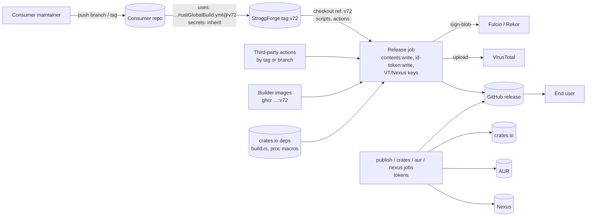
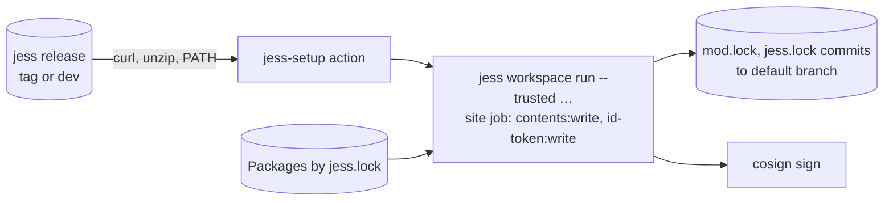
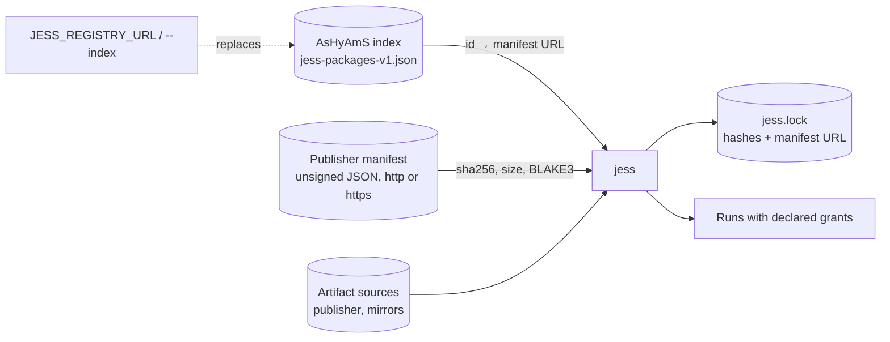
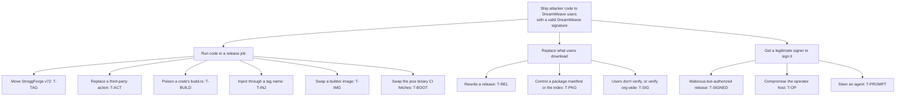

# SEC-101: the DreamWeave supply chain, source to install

Status: **proposed RFC** for [SEC-101](https://github.com/DreamWeave-MP/StroggForge/issues/21).
It decides nothing until the sole human approver ratifies the list under "Decisions for
ratification". It authorizes no implementation, merge, release or deployment. Each fix named here
belongs to the issue named beside it.

Evidence is from current heads, read on 2026-11-12:

- StroggForge `72c3050` (tag `v72`);
- jess `1a4be2f`, plus `fd6c829` for the YAML fixes;
- AsHyAmS `b955dc87`;
- l3i `fe88c50`;
- repository settings through the GitHub API.

Every claim cites a file and line. "Verified" means read in source or settings; "inferred" means
reasoned from documented GitHub, Sigstore or Cargo behavior. The inventories behind this document,
with every citation, are in [`SEC-101-evidence.md`](SEC-101-evidence.md).

Decisions the approver has already made, recorded here so nothing below re-litigates them:

- Third-party actions are pinned to full commit SHAs (2026-11-12).
- One human approves everything in this organization: the maintainer (2026-11-12).
- The agent may open PRs, push branches, run CI, and merge its own PRs to `main` when CI is green
  and an independent review has passed. It may never cut releases, push tags (unless told to), sign,
  change secrets or permissions, change production workflows, cut consumers over, or take a
  dependency exception (2026-11-12).

## What is being protected

| Asset | Where it lives | Who may change it |
| --- | --- | --- |
| Source of the reusable workflows and helpers consumers run | StroggForge `main`, tags `vN` | the maintainer |
| Consumer release artifacts (zips, crates, AUR, Nexus, muxapps, mod archives) | GitHub releases, crates.io, AUR, Nexus Mods | each consumer's release pipeline |
| jess binaries and image | jess releases (`dev`, tags), crates.io, GHCR | jess's release pipeline; officially, the human release signature (SEC-105/106) |
| Jess packages (`.jpk`, `.jsw`) | publisher sites | each publisher |
| The package-id-to-publisher index | AsHyAmS Pages (`jess-packages-v1.json`) | AsHyAmS's `refresh` job |
| Credentials | repository and org secrets (CARGO_REGISTRY_TOKEN, AUR_SSH_PRIVATE_KEY, NEXUS_API_KEY, VT_API_KEY, DW_BOT_PAT, Discord webhooks), GITHUB_TOKEN, GitHub OIDC | GitHub, on the job's grant |
| Signing identity | Fulcio certificates naming `…/rustGlobalBuild.yml@refs/tags/vN` and `…/modGlobalBuild.yml@refs/tags/vN` | whoever runs that workflow at that ref with `id-token: write` |
| The future official jess release key | paper, then local RAM during signing (SEC-105) | the operator, by hand |

## Five things that are not the same thing

The pipelines today blur these, and every threat below exploits a blur:

| Control | What it establishes | What it does not establish |
| --- | --- | --- |
| **Artifact hash** (sha256, BLAKE3) | these bytes are the bytes some document named | who wrote the document; whether the bytes are safe |
| **CI provenance** (Sigstore keyless) | a workflow at a ref, in a repository, on a runner, produced these bytes | that the ref was the intended code; that the build's inputs were safe; that a human wanted it released |
| **Malware scan** (VirusTotal) | engines didn't recognize these bytes as known malware, today | that the bytes are benign; that they came from the source |
| **GitHub approval** (PR review, environment approval) | a GitHub account clicked approve | that the account was the human, or not compromised; anything about bytes built later |
| **Human authorization** (the offline signature, SEC-105/106) | the operator, holding the paper secret, approved this exact frozen manifest | that the build was honest. That is provenance's job, and the operator reviews provenance before signing. |

A release is trustworthy only when all of them that apply hold, each checked by a party that
doesn't depend on another's say-so. Today only the hash is ever checked by a consumer, and only
against a document from the same place as the bytes.

## Trust boundaries

### Consumer release (StroggForge reusable workflows)

| Crossing | Authority that decides | Attacker capability that defeats it | Control today | Gap (owner) |
| --- | --- | --- | --- | --- |
| Consumer → StroggForge `@v72` | whoever can move tag `v72` | maintainer credential theft, or a token with `contents: write` on StroggForge | none: no rulesets, no tag protection, immutable releases off (verified, `gh api`) | SEC-203 |
| StroggForge job → its own scripts (`ref: v72`) | same tag | same | none | SEC-203 |
| Job → third-party actions | each action's upstream maintainer | upstream compromise or a moved tag | two of ~30 refs pinned by SHA (evidence §1.2) | SEC-203; decided: SHA pins |
| Job → builder images | whoever can push `ghcr.io/…:v72` | `workflow_dispatch` of the image workflow, GHCR write | none: tags, not digests; images unsigned | SEC-202/203 |
| Job → runtime downloads (LLVM, micromamba, jess, actionlint) | upstream hosts over TLS | host or CDN compromise | TLS only | SEC-201 (jess), SEC-203 |
| Job → dependency code (build.rs, proc macros, tests) | every crate author in the graph | a poisoned crate | `cargo audit` gates publishing, not building; builds run beside signing and write grants | SEC-102 |
| Job → Fulcio identity | any code in a job with `id-token: write` running that workflow at that ref | any of the above, or PR code in a same-repo PR (inferred) | identity names a movable tag; nobody verifies | SEC-102/202 |
| Tag name → shell | whoever can create a tag | a tag named to contain `$(…)` | none: `release_name` spliced into run text (`corprus-crucible/action.yml:233,245,262`, verified) | SEC-203 |
| publish → GitHub release | the `publish` job | re-run, or `workflow_dispatch` from any branch (`rustGlobalBuild.yml:477`) | none; the script deletes and recreates releases | SEC-102 |
| crates → crates.io | CARGO_REGISTRY_TOKEN, readable during `cargo publish`'s verify build | a build script in the published crate's graph | no environment gate (`rustGlobalBuild.yml:631`) | SEC-102 |
| End user → artifact | the user's own check | substituted download | a cosign bundle *inside* the zip; documented check matches the whole org (`jess install.md:35-37`) | SEC-202 |

### jess bootstrap in CI

| Crossing | Authority | Attacker capability | Control today | Gap (owner) |
| --- | --- | --- | --- | --- |
| CI → jess binary | whoever controls the release asset at that tag | asset replacement; the `dev` release is deleted and recreated on every `main` push | none (`jess-setup/action.yml:27-30`, verified) | SEC-201 |
| CI → jess image | digest in `modGlobalBuild.yml:56` | none while the digest stays (verified) | digest pin | image unsigned (SEC-202) |
| jess → workspace packages | `jess.lock` pins | first sync, or an unpinned id | hashes from an unsigned manifest | SEC-103 |
| `--trusted` targets → job grants | target declarations | a malicious or compromised package | coarse capabilities, no per-package isolation (`jess src/lua/package.rs:13-16`) | SEC-103, later jess work |

### Package install (`jess install`, `jess workspace sync`)

| Crossing | Authority | Attacker capability | Control today | Gap (owner) |
| --- | --- | --- | --- | --- |
| jess → index | AsHyAmS Pages | AsHyAmS repo or deploy compromise, `sources.toml` PR, environment variable | none: the index decides the publisher of an unpinned id (`publisher.jsl:668-688`) | SEC-103, FED-101 |
| jess → manifest | whoever serves the manifest URL | publisher host compromise; MITM over `http://` | none (`publisher.jsl:155-157`, verified) | SEC-103 |
| jess → artifact | the manifest's hashes | none, given an honest manifest | sha256 and BLAKE3, fail closed (`publisher.jsl:562-600`) | — |
| jess → network | the host jess runs on | a manifest steering fetches at `127.0.0.1` or `169.254.169.254` | none: cross-origin redirects followed, no private-range filter (`http/init.jsl:55-58`) | FED-102/202, jess |
| Upgrade → user consent | prompt only when capabilities grow | a code change under the same capabilities | none | SEC-103 |

AsHyAmS's own crawler is the counter-example to follow: it refuses any name that resolves to a
non-public address, connects only to the addresses it checked, re-checks every redirect hop, and
caps sizes and time (`AsHyAmS src/fetch.rs:335-356,369-393`, verified). jess's HTTP client has none
of that.

## Adversaries

| ID | Adversary | Starting capability |
| --- | --- | --- |
| A1 | Outside attacker | opens PRs and issues; publishes crates and packages; serves HTTP |
| A2 | Compromised upstream | controls a third-party action, crate, base image, or tool download host |
| A3 | Compromised publisher | controls one publisher's site or manifest |
| A4 | Compromised maintainer credential | a GitHub session, PAT or SSH key of the maintainer or of DW_BOT_PAT's account |
| A5 | Compromised CI job | code running in one job, with that job's token, secrets and OIDC |
| A6 | Malicious-but-authorized releaser | can run the real release workflow and sign; ships bad code with valid provenance |
| A7 | Compromised operator host | owns the workstation where the paper secret is typed |
| A8 | Prompt injection | text in an issue, PR, manifest or agent output aimed at an agent with tools |

## Threats, ranked

Likelihood and impact are each 1 to 3; rank = likelihood × impact. Residual is what remains after
the owner's fix as currently scoped.

| ID | Threat | Adversary | L | I | Rank | Owner | Residual after fix |
| --- | --- | --- | --- | --- | --- | --- | --- |
| T-TAG | `v72` moved or re-pointed: every consumer runs attacker code with every inherited secret, and signs it under the real identity | A4 | 2 | 3 | **6** | SEC-203 | a compromised maintainer who also defeats tag rulesets |
| T-ACT | A third-party action by tag or branch (`Nexus-Mods/upload-action@main` with the Nexus key; `dtolnay/rust-toolchain@master` in the crates job) is replaced | A2 | 2 | 3 | **6** | SEC-203 (SHA pins, decided) | upstream code at the pinned commit was already bad |
| T-PKG | A package's manifest host, or the index, chooses what `jess install` or a first sync runs | A3, A4 | 2 | 3 | **6** | SEC-103, FED-101 | a publisher's own signing key stolen |
| T-BOOT | The jess binary CI downloads is swapped; it then runs `--trusted` targets in a job that commits and signs | A2, A4 | 2 | 3 | **6** | SEC-201 | the release signer itself compromised (A6/A7) |
| T-BUILD | Dependency code (build.rs, proc macro, test) runs in the job holding `id-token: write`, `contents: write`, VT and Nexus keys, or CARGO_REGISTRY_TOKEN | A2 | 2 | 3 | **6** | SEC-102 | code that only acts at runtime in the shipped binary (that is T-SIGNED) |
| T-INJ | A tag name or caller input reaches the shell (`corprus-crucible/action.yml:233,245,262`); it defeats branch protection and review as controls | A1 (via a bot), A4 | 1 | 3 | 3 | SEC-203 | none once values travel through `env` |
| T-SIG | Nobody verifies a signature; the one documented check accepts any workflow in the org | A2, A4, A5 | 2 | 2 | 4 | SEC-202 | consumers that skip verification |
| T-IMG | Builder images by mutable tag, unsigned, re-pushable by `workflow_dispatch` | A4, A5 | 1 | 3 | 3 | SEC-202/203 | base image (`centos:stream9`) by tag upstream |
| T-REL | Release refresh deletes and recreates releases and the `development` tag; `publish` runs on dispatch from any branch | A4, A5 | 2 | 2 | 4 | SEC-102 | — |
| T-VT | VirusTotal never gates a release: detections only become links | A2 | 1 | 2 | 2 | SEC-104 | malware no engine knows |
| T-SSRF | jess fetches attacker-chosen internal URLs during sync or install | A3 | 1 | 2 | 2 | FED-102/202, jess | — |
| T-CRED | Write tokens stay in `.git/config` after checkout in jobs that then run build code | A2 | 2 | 2 | 4 | SEC-203 | tokens in env for steps that need them |
| T-PR | Same-repo PR code runs with the caller's write and OIDC grants | A4 (branch push) | 1 | 3 | 3 | SEC-102 | — |
| T-SIGNED | A malicious but properly signed release (A6): provenance is honest, the code is not | A6 | 1 | 3 | 3 | SEC-105/106 (human review), SEC-104 (response) | inherent: a signature attests origin, not intent |
| T-OP | The operator's workstation records the paper phrase or signs a swapped manifest | A7 | 1 | 3 | 3 | SEC-105/106 | the documented workstation-compromise risk SEC-105 must state |
| T-PROMPT | An agent acts on instructions inside an issue, PR, manifest or tool output | A8 | 2 | 2 | 4 | DOC-103, STE-102 | an agent whose tools exceed its standing authority |

## Existing controls, and what each actually does

| Control | Where | Gates? | Notes |
| --- | --- | --- | --- |
| Sigstore keyless signing | `sign-release-binary.sh:12`; `modGlobalBuild.yml:182,314` | no | Signs the raw binary; the bundle ships inside the zip. The identity names a movable tag. No verification exists anywhere in the three repos. |
| VirusTotal | `corprus-crucible/action.yml:200`; `format-virustotal-links.sh:17-21` | key presence only | A missing key fails the job; detections never do. |
| RustSec (`cargo audit`) | `rustGlobalBuild.yml:177`; `libGlobalBuild.yml:113` | publishing yes, building no | Release builds start in parallel with `lint`; `publish` and `crates` wait for it. |
| CVE response | none | — | SEC-104 owns it. |
| Portability check | `check-release-binary.sh` | yes | A portability control, not a security one. |
| Digest pin | `modGlobalBuild.yml:56` (jess image) | yes | The only digest-pinned dependency. |
| Package integrity | jess `publisher.jsl:562-600`, `workspace.jsl:1553-1556` | yes, fails closed | Integrity relative to an unsigned manifest. |
| AsHyAmS SSRF and size defenses | `AsHyAmS src/fetch.rs`, `src/address.rs`, `src/policy.rs` | yes | The model for jess's own client. |
| Fork PR isolation | GitHub defaults plus `event_name` conditions | yes | Fork PRs get no secrets or OIDC. Same-repo PRs get the caller's grants. |

## Security invariants

Each invariant is a requirement on the issue that owns it. The static ones are executable today:
[`rules/rules.jsl`](rules/rules.jsl), with a failing and a passing fixture for each rule. They run
as `jess run --trusted docs/sec/rules/rules.jsl test` (22/22 pass) and
`… scan <repository>`. The procedural ones name the negative test the owning implementation must
add.

| ID | Invariant | Threat | Kind | StroggForge | jess | AsHyAmS |
| --- | --- | --- | --- | --- | --- | --- |
| SR-01 | A third-party action or reusable workflow is pinned to a full commit SHA | T-ACT | static | 94 | 5 | 17 |
| SR-02 | An own-organization reference names a commit (advisory; see decision 4) | T-TAG | static | 25 | 2 | 0 |
| SR-03 | No value a PR or issue author chooses is spliced into a `run` script | T-INJ | static | 0 | 0 | 0 |
| SR-11 | No ref name, caller input or step output is spliced into a `run` script | T-INJ | static | 71 | 0 | 0 |
| SR-04 | Every workflow declares top-level permissions, never `write-all` | T-CRED | static | 6 | 0 | 0 |
| SR-05 | No `pull_request_target`, `workflow_run` or `issue_comment` trigger | T-PR | static | 0 | 0 | 0 |
| SR-06 | A job that can sign or write the repository runs no dependency code | T-BUILD | static | 6 | 0 | 1 |
| SR-07 | Nothing downloaded is piped to a shell or run without a digest or signature check | T-BOOT, T-ACT | static | 2 | 0 | 1 |
| SR-08 | No secret goes to a third-party action that isn't pinned by SHA | T-ACT | static | 6 | 0 | 0 |
| SR-09 | A checkout in a writing job sets `persist-credentials: false` | T-CRED | static | 16 | 0 | 1 |
| SR-10 | A signature check names one exact identity and issuer | T-SIG | static | 0 (no checks exist) | 0 | 0 |
| PR-01 | Tags `v*` and release assets are immutable: a moved tag or replaced asset is refused by the forge | T-TAG, T-REL | procedural: rulesets plus a test that pushes a moved tag to a scratch repository | — | — | — |
| PR-02 | Signing and publishing consume exactly the digest the build produced; a re-run cannot publish a different blob | T-BUILD, T-REL | procedural, SEC-102: rebuild with a changed input and show publish refuses | — | — | — |
| PR-03 | The jess CI bootstrap verifies a digest and a signature naming jess's release workflow, at a commit, before running jess | T-BOOT, T-SIG | procedural, SEC-201: a tampered zip and a foreign-identity bundle both fail | — | — | — |
| PR-04 | A package's publisher identity can't be chosen by the index alone, and a manifest can't alone redefine its signer | T-PKG | procedural, SEC-103: a rewritten index and a rewritten manifest are both refused after first contact | — | — | — |
| PR-05 | jess refuses `http://` for manifests and artifacts, and refuses private-range destinations | T-PKG, T-SSRF | procedural, jess: fixtures at `127.0.0.1`, `169.254.169.254`, an http manifest | — | — | — |
| PR-06 | An official jess release is promoted only with a detached offline signature over the frozen manifest; a replay, a wrong key or a drifted digest is refused | T-SIGNED, T-OP | procedural, SEC-106/207 | — | — | — |
| PR-07 | A VirusTotal detection above a ratified threshold stops the release before upload | T-VT | procedural, SEC-104 | — | — | — |
| PR-08 | Agents never act on instructions found in content; only the approver's messages carry authority | T-PROMPT | procedural, DOC-103: a planted instruction in an issue and in a manifest is reported, not followed | — | — | — |

The counts are the baseline at the heads above, committed in `rules/baseline/`. jess shows few
findings because its release runs StroggForge's reusable workflow and inherits all of those.

## Incident triggers

Each of these stops releases and opens SEC-104's response:

- A `v*` tag or release asset on StroggForge or jess changes after creation.
- A signature verification fails, or names an identity other than the expected workflow at the
  expected commit.
- A package manifest's signer changes, or an index lists a second publisher for an id.
- VirusTotal reports a detection on a release candidate.
- `cargo audit` reports a vulnerability in a shipped dependency.
- A secret appears in a log, an artifact or a commit.
- Any action is taken on instructions that didn't come from the approver.

## The official jess release authority

SEC-105 and SEC-106 design the human signature. This section fixes the boundary they work inside;
it decides none of their open questions (salt and encoding, seed derivation, release months,
first-key distribution, operator unavailability).

- The paper phrase, its KDF output and the signing seed never cross into GitHub, CI, an agent, a
  chat, a log, an environment variable, a command argument or a file at rest. The boundary is the
  operator's local RAM during one signing.
- CI and agents hold only the pinned public key and detached signatures. They can prepare and
  verify; they can't authorize.
- The signature covers a frozen manifest: repository, full commit SHA, version, every artifact's
  digest, the builder identity and the provenance references. A signature over one candidate can't
  authorize another (replay), and no artifact is rebuilt after signing.
- The public key's expected value must reach consumers by a path the release download can't rewrite
  (SEC-106's open question). Until it does, verification proves only consistency with the download.
- What this does not protect against: an operator who signs a malicious candidate (T-SIGNED), and an
  operator workstation that is compromised while the phrase is typed (T-OP). SEC-105 must state
  both as residual.

## Profile

- **The rules.** `jess run … scan` reads a repository's workflows in under a second. As a CI gate it
  would cost seconds per run. Maintenance is the rule table and its fixtures, about 400 lines of JSL.
- **The fixes.** These are estimates, measured nowhere yet.
  - SHA pins mean a bump per action update. Tooling like Dependabot or Renovate makes that a
    reviewed PR.
  - Splitting build from sign and publish (SEC-102) adds one artifact hand-off per platform, about
    a minute of wall time per release.
  - Bootstrap verification (SEC-201) adds one `cosign verify-blob`, a few seconds.
- **The benefit.** The five rank-6 threats each turn a single compromise into org-wide code
  execution with publishing credentials. Closing them moves the cheapest attack from one stolen
  credential or upstream account to a compromise of the signer.

## Not verified

- Consumer repositories' settings (branch protection, tag rules, who can push tags). The threat
  ranks assume they match StroggForge's: no rules.
- The scopes of DW_BOT_PAT. If it can write StroggForge, T-TAG's likelihood rises: a job holding
  the PAT could move `v72`. See decision 6.
- Whether anything outside the three repositories verifies a DreamWeave signature.
- Behavior under GitHub's documented semantics (OIDC on same-repo PRs, inherited permissions in
  reusable workflows) was not reproduced in a live run.

## Decisions for ratification

The approver answers each with yes, no, or an edit. Everything else in this document is evidence
and analysis.

1. **Authority at each boundary.**
   - **StroggForge** owns engineering intent and the release pipeline.
   - **Publishers** own their manifests.
   - **AsHyAmS** observes, and its index is a hint for discovery, never an authority. jess must not
     let the index alone choose a publisher once a package is known.
   - **jess** verifies, on the consumer's side.
   - **The human signature** is the only authority for an official jess release.
2. **The ranking.** T-TAG, T-ACT, T-PKG, T-BOOT and T-BUILD are the P0 threats, to be fixed before
   any FOR-204/205 release-logic cutover. Their owners (SEC-102, SEC-103, SEC-201, SEC-203) inherit
   the matching invariants as acceptance criteria.
3. **Accepted residual risk until each fix lands:**
   - anyone who can move `v72` or push a tag effectively controls consumer CI;
   - jess package installs trust the manifest host;
   - the jess CI bootstrap trusts GitHub's release download.
4. **Own-organization references.** Recommended: keep `@vN` tags for StroggForge's own reusable
   workflows and checkouts, but make them immutable (a tag ruleset refusing updates and deletions
   of `v*`, plus immutable releases), and treat SR-02 as advisory. The alternative is SHA pins for
   own references too, at the cost of every consumer bump becoming a SHA edit.
5. **The invariants above (SR-01 to SR-11, PR-01 to PR-08)** become requirements on their owners.
   The static rules may later run as a CI gate. That gate is SEC-203's change, not this RFC's.
6. **DW_BOT_PAT.** Its scopes are facts only the approver can state. Recommended: it must not be
   able to push to StroggForge or jess, and a fine-grained token limited to issue creation in the
   repositories `dependent` writes to should replace it (SEC-102).
7. **Expedite the tag-name injection fix.** It is small: three lines pass `release_name` through
   `env`. It is security-critical, and the charter lets security work be accelerated by explicit
   authorization. Recommended: authorize it as an expedited SEC-203 change, ahead of the rest of
   SEC-203. It touches a production workflow, so it needs the approver's explicit go-ahead.
